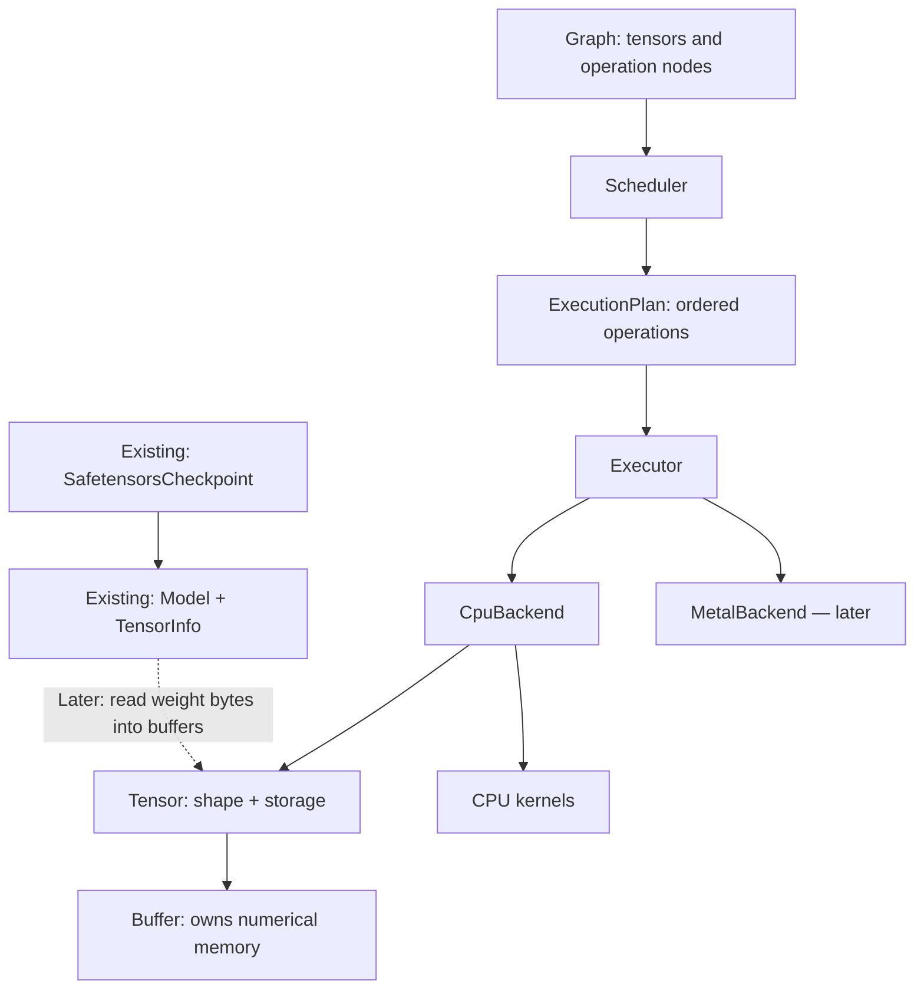

# Computation runtime architecture

This document records the proposed organization for building a computation graph,
CPU and Metal backends, and device scheduling. It is a development guide, not a
claim that all components are implemented.

## Starting point

`Checkpoint` defines the loading interface. `SafetensorsCheckpoint::load()` returns
a `Model` containing configuration and a map of `TensorInfo` records. Those records
describe tensor dtype, shape, and absolute byte ranges in the checkpoint; they do
not contain numerical weight data. `main()` currently loads and prints metadata.

The repository also has initial `src/runtime/tensor.hpp` and
`src/backends/cpu/cpu_buffer.hpp` files. Extend those files as the runtime develops.
Keep the checkpoint loader working alongside the new runtime.

Currently, the buffer header declares `CpuBuffer<T>` without its storage or method
definitions. The tensor header defines a non-owning `TensorView<T>` with a pointer,
shape, and strides. Preserve those names if useful: implement `CpuBuffer<float>`
first and let a view borrow its data. A `TensorView` alone does not keep its buffer
alive. The existing dtype enum contains only `FP16`; the initial runtime exercises
below use FP32, so the dtype description must match the actual element type.

## Execution flow



The diagram shows the target architecture. Initially, the executor can visit nodes
in insertion order when every input is defined before use. Introduce a separate
scheduler and execution plan when dependency ordering or device placement needs
its own policy.

## Types and responsibilities

| Type | Kind | Responsibility |
| --- | --- | --- |
| `TensorInfo` | Existing struct | Describe tensor data in a checkpoint file. Keep file offsets out of numerical kernels. |
| `Tensor` | Struct | Describe a runtime tensor's shape, dtype, and storage handle. Initially support contiguous FP32 CPU tensors. |
| `Buffer` | Future interface | Represent owned numerical storage across backends. Add the abstraction when Metal needs it; include a virtual destructor when destroying derived objects through it. |
| `CpuBuffer` | Class | Own CPU storage, initially a `std::vector<float>`, and expose fixed-size views of its elements. |
| `MetalBuffer` | Future class | Own and release a Metal buffer. |
| `Node` | Struct | Record an operation enum, input tensor IDs, and an output tensor ID. Start with `MatMul`, then `Add` and `ReLU`. |
| `Graph` | Class | Own tensor records and nodes. Validate shapes and record operations without executing them. Nodes refer to tensors by ID. |
| `Backend` | Future interface | Define allocation, supported operations, execution, and synchronization. Start with synchronous execution semantics. |
| `CpuBackend` | Class | Allocate CPU buffers and dispatch operations to CPU kernels. |
| `MetalBackend` | Future class | Load Metal kernels, encode and submit commands, and manage completion. |
| `Scheduler` | Future class | Choose dependency-safe execution order and device placement. Start with explicit placement; later arrange transfers and synchronization. |
| `ExecutionPlan` | Future struct | Hold ordered compute steps, then transfer and synchronization steps when needed. |
| `Executor` | Class | Follow the execution order, allocate output storage, and dispatch to backends. Leave placement policy to the scheduler. |

Keep numerical kernels as free functions rather than creating a class for each
operation. A kernel receives inputs and caller-provided output storage; it does
not parse JSON, load checkpoints, or choose a device.

## Ownership and CPU data access

`CpuBuffer` owns the allocation. `Tensor` describes how to interpret it. A `[2, 3]`
tensor can refer to six contiguous floats: `[1, 2, 3, 4, 5, 6]`.

The intended initial buffer interface is shown below for floats. Your existing
templated declaration can provide the same API through `CpuBuffer<float>` with
`std::vector<T>` storage; changing it to a non-template is optional. If keeping the
template, keep definitions visible in the header unless using explicit template
instantiation in a source file.

```cpp
class CpuBuffer {
public:
    explicit CpuBuffer(std::size_t element_count);
    std::size_t size() const;
    std::span<float> data();
    std::span<const float> data() const;

private:
    std::vector<float> storage_;
};
```

The constructor allocates the requested number of floats. `size()` counts elements,
not bytes. The mutable `data()` overload allows writing; the const overload allows
reading only. A span is a non-owning view of existing elements and does not copy
or allocate data. It must not outlive its buffer. Keep resizing out of the public
interface so callers cannot invalidate views by resizing storage.

Initially, a tensor can refer directly to a `CpuBuffer`. Make the storage ownership
choice explicit: if tensor copies share storage, mutations are shared too; copying
a tensor handle should not accidentally copy an entire numerical allocation.
The graph should keep storage alive while operations use it.

## Proposed file layout

This is the target layout, not a request to create all files immediately. Existing
checkpoint and model files remain in place.

```text
src/
├── runtime/
│   ├── tensor.hpp
│   ├── buffer.hpp                   # When a common storage interface is needed
│   ├── graph.hpp / graph.cpp        # Node and Graph
│   ├── backend.hpp                  # Common backend interface
│   ├── scheduler.hpp / scheduler.cpp
│   ├── execution_plan.hpp
│   └── executor.hpp / executor.cpp
└── backends/
    ├── cpu/
    │   ├── cpu_buffer.hpp / cpu_buffer.cpp
    │   ├── cpu_backend.hpp / cpu_backend.cpp
    │   └── kernels.hpp / kernels.cpp
    └── metal/                       # Later
```

## Build order and completion checks

### 1. CPU storage and matrix multiplication

Implement `CpuBuffer`, a minimal `Tensor`, and a row-major FP32 multiplication
kernel. Use synthetic values so checkpoint work does not block runtime learning.

```cpp
void matmul_cpu(
    std::span<const float> a,
    std::span<const float> b,
    std::span<float> output,
    std::size_t m,
    std::size_t k,
    std::size_t n);
```

Inputs have shapes `[m, k]` and `[k, n]`; output has shape `[m, n]`. Check storage
sizes before accessing elements. The output must not overlap the inputs for this
initial implementation. Compute into the supplied output without allocating.

Add a separate `runtime_test` executable to CMake and register it with CTest. Keep
`main()` focused on checkpoint inspection. The first numerical check is:

```text
A = [[1, 2, 3],       B = [[7,  8],
     [4, 5, 6]]           [9, 10],
                          [11,12]]

A × B = [[58,  64],
         [139,154]]
```

Completion: correct output and clean rejection of incompatible buffer sizes.

### 2. CPU graph execution

Wrap the working kernel in `CpuBackend`. Add `Node`, `Graph`, and `Executor`.
Graph construction records work; execution performs it. Start with a single
matrix multiplication, then run:

```text
X → MatMul(W1) → Add(b1) → ReLU → MatMul(W2) → Y
```

Define the supported addition shapes explicitly before implementing bias addition.
Completion: graph results agree with direct kernel execution and an independent
NumPy reference.

### 3. Metal execution

Introduce common buffer and backend interfaces, then implement Metal storage and
kernels. Run the same graph entirely on GPU before mixing devices.
Completion: CPU/GPU numerical agreement within a stated tolerance.

### 4. CPU/GPU scheduling

Extract `Scheduler` and `ExecutionPlan`. Use explicit device placement first.
Order work by dependencies, ensure data is available to the consuming backend,
and synchronize before consumers access unfinished results. Shared physical memory
on the M4 still requires correct access and synchronization.

Completion: a deliberately mixed CPU/GPU graph produces the same result as the
CPU graph. Automatic placement follows measurements of compute, transfer, and
synchronization costs.

### 5. Weight integration and further runtime work

Connect the existing checkpoint metadata to runtime storage:

```text
TensorInfo → read weight bytes → convert BF16 to FP32 → runtime Tensor
```

Later add memory lifetime planning and buffer reuse, then transformer operations
such as RMSNorm, RoPE, attention, and a gated MLP. Use the resulting runtime to
execute a Qwen transformer block before assembling the full decoder.

## Working boundary

The learner implements the runtime and kernels. Teaching and review should focus
on consequential correctness, ownership, design, and performance issues. This
checked-in architecture guide contains technical project guidance; private
motivation and personal learning notes remain outside version control.
